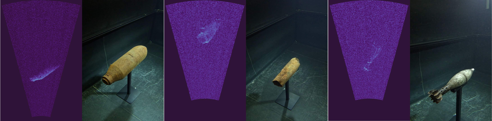
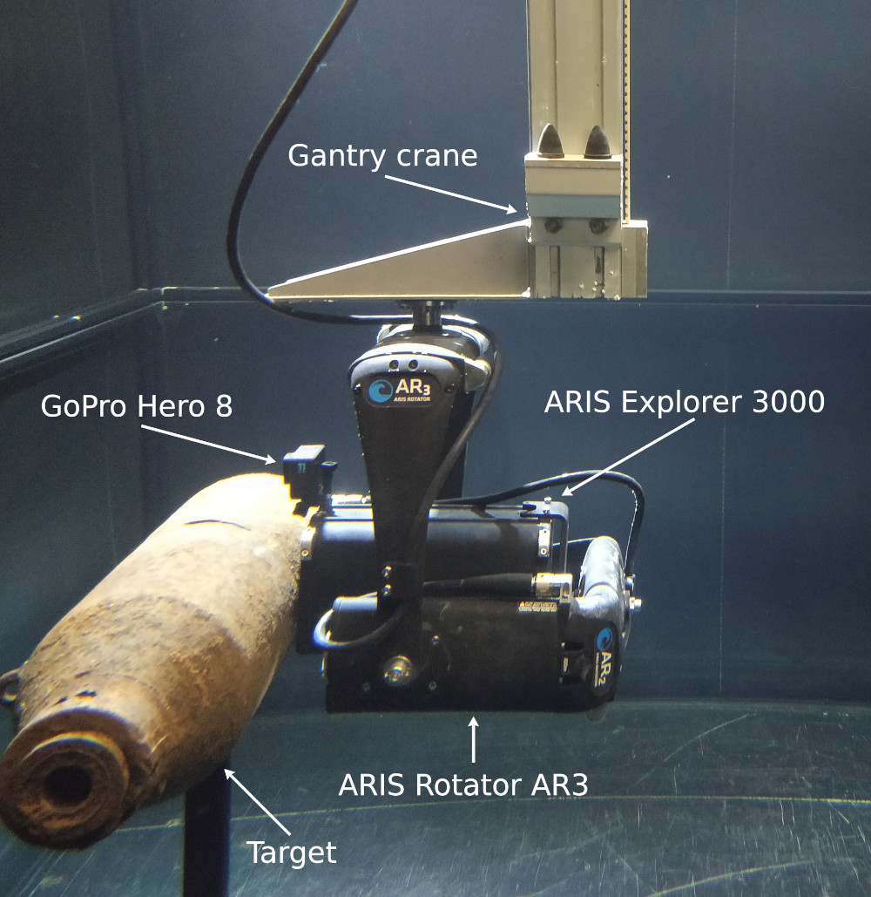

# About


During the 20st century, millions of tons of munition were dumped into the oceans worldwide. After decades of decay, the problems these unexploded ordnance (UXO) are causing are starting to become apparent. In order to facilitate more efficient salvage efforts through e.g. autonomous underwater vehicles, access to representative data is paramount. However, so far such data is not publicly available. 

We present a dataset of multimodal synchronized data for acoustic and optical sensing of UXO underwater. Using an ARIS 3000 imaging sonar, a GoPro Hero 8 and a custom design gantry crane, we recorded close to 100 trajectories and over 74,000 frames of 3 distinct types of UXO in a controlled environment. Included in this dataset are raw and polar transformed sonar frames, annotated camera frames, sonar and target poses, textured 3D models, calibration matrices, and more. It is intended for research of acoustic and optical perception of UXO underwater and was recorded in a controlled experimental environment. 



This dataset has the following properties:

 - Sonar scans of multiple UXO using an ARIS Explorer 3000 imaging sonar.
 - Matched GoPro UHD frames for most sonar frames.
 - Labels for GoPro frames (*multiply coordinates by 3!*)
 - Known and accurate transforms between sonar and targets.
 - Known details of UXO targets including munition types, dimensions, and 3D models.
 - Tracked scan trajectories that are typical and achievable for non-experimental environments.
 - Publicly available at [https://zenodo.org/records/13778485].
 - Export scripts available at [https://github.com/dfki-ric/uxo-dataset2024].

This repository contains the code we used to prepare the raw recordings for export. A more in-depth description of the data can be found with the dataset itself and the accompanying [PAPER](https://www.researchgate.net/publication/386124306_An_Acoustic_and_Optical_Dataset_for_the_Perception_of_Underwater_Unexploded_Ordnance_UXO).


# Citing
When using this dataset or the code used to process it, please cite the following paper:

```bibtex
@INPROCEEDINGS{dahn2024uxo,
  author={Dahn, Nikolas and Firvida, Miguel Bande and Sharma, Proneet and Christensen, Leif and Geisle, Oliver and Mohrmann, Jochen and Frey, Torsten and Kumar Sanghamreddy, Prithvi and Kirchner, Frank},
  title={An Acoustic and Optical Dataset for the Perception of Underwater Unexploded Ordnance (UXO)}, 
  booktitle={OCEANS 2024 - Halifax}, 
  year={2024},
  doi={10.1109/OCEANS55160.2024.10754316}
}
```


# Code Overview

## Viewing the data
The exported data uses simple, well-established formats, namely .pgm, .jpg, .csv, .yaml, .json, and .txt. For convenience, we provide a script that loads an exported recording and allows to step through datapoints in a synchronized fashion using the arrow keys. To view a recording, use the following command:

```bash
python scripts/view_recording.py data_export/recordings/<target_type>/<recording-folder>
```

## Visualizing the data in Rerun
[`rerun_viz/log_to_rerun.py`](rerun_viz/log_to_rerun.py) logs recordings to [Rerun](https://rerun.io), so you can scrub through the GoPro, ARIS and gantry data together in one synchronized 3D scene.

For each recording it shows:

 - **Scene (3D):** the gantry and AR3 pose chain from `calibration/transforms.yaml`, `gantry.csv` and the AR3 pan/tilt/roll in `aris_frame_meta.csv`. It also includes the full AR3 trajectory, the target pose, the GoPro camera frustum, the ARIS field of view (an orange frustum: ±15° horizontally, `--sonar-elevation` vertically, between the window start and end range) and the ARIS returns back-projected into 3D.
 - **GoPro:** each frame with its bounding-box label, the ARIS field-of-view outline and the ARIS returns projected into the image.
 - **ARIS polar:** the polar-transformed sonar image.
 - **Plots:** gantry position and AR3 pan/tilt/roll over time.
 - **Target scan / Notes:** the textured 3D model of the target (in its own view, since the scans are not registered to the target frames) and the recording notes.

Two timelines are available: `aris_frame` (frame index) and `time` (ARIS timestamp).

### 1. Install
Use Python 3.10 to 3.12 (the pinned NumPy has no wheels for newer versions). Create a virtual environment:

```bash
python -m venv .venv
```

Activate it (`source .venv/bin/activate` on Linux/macOS, `.venv\Scripts\activate` on Windows), then install the requirements:

```bash
pip install -r requirements.txt
```

### 2. Download the data
The full dataset is about 95 GB. The 1.7 GB sample contains five complete recordings (100 lbs bomb, 15 cm mortar and 20 lbs incendiary, as left-to-right sweeps and flybys) and is enough to get started. Download it together with the 3D models:

```bash
mkdir -p data_download && cd data_download
```

```bash
curl -L -o sample.7z https://zenodo.org/api/records/13778485/files/sample.7z/content
```

```bash
curl -L -o data_export_3dmodels.7z https://zenodo.org/api/records/13778485/files/data_export_3dmodels.7z/content
```

```bash
python -m py7zr x sample.7z extracted && python -m py7zr x data_export_3dmodels.7z extracted && cd ..
```

This produces `data_download/extracted/uxo_samples/<recording>/` and `data_download/extracted/3d_models/`. The calibration is already part of this repository. For the full export, download `data_export_recordings.7z` (16.7 GB, about 33 GB unpacked) from [Zenodo](https://zenodo.org/records/13778485) instead and point the script at its `recordings/<target_type>/` folders.

### 3. Visualize
Stream a single recording into a Rerun viewer:

```bash
python rerun_viz/log_to_rerun.py data_download/extracted/uxo_samples/2023-09-20_180722 --spawn
```

Or write one `.rrd` file per recording (pass a folder to log every recording in it), then open them all at once. The recordings show up under *Sources* in the viewer:

```bash
python rerun_viz/log_to_rerun.py data_download/extracted/uxo_samples --save-dir data_download/rrd
```

```bash
rerun data_download/rrd/*.rrd
```

Logging all five sample recordings takes a few minutes and produces about 1.9 GB of `.rrd` files.

### Options

| Option | Default | Description |
|---|---|---|
| `--overlay-mode {band,line}` | `band` | How ARIS returns are drawn in the GoPro image. `band` spreads every return over the vertical aperture as a heatmap, weighted by the beam pattern (half strength at the edges). `line` draws each return as a point at zero elevation. |
| `--sonar-elevation` | `14` | Vertical aperture of the ARIS in degrees, used for the frustum and the band overlay. |
| `--threshold` | `35` | Minimum raw ARIS intensity (0–255) for a return to be shown. |
| `--bin-step` | `2` | Range-bin subsampling of the ARIS frame. |
| `--every` | `1` | Log only every n-th frame, for quick previews. |
| `--overlay-alpha` | `200` | Maximum opacity (0–255) of the sonar overlay in the GoPro image. |
| `--overlay-radius` | `2.0` | Point radius of the `line` overlay. |
| `--models` | `data_download/extracted/3d_models` | Folder with the target `.obj` scans. |
| `--calibration` | `calibration/transforms.yaml` | Static transforms. |

### Notes and limitations
 - The ARIS measures range and bearing but not elevation, so a return could have come from anywhere in the vertical aperture. This is why `band` mode is the default. The `line` overlay and the 3D returns place everything at zero elevation.
 - The 14° vertical aperture is the ARIS Explorer 3000 specification; it is not stored in the data.
 - The ARIS beam angles come from `scripts/common/aris_definitions.py`. The left/right sign follows the convention of `prep_2_aris_to_polar.py` and has not been verified independently.
 - GoPro frames use the `linear` intrinsics from `calibration/camera_parameters/` and are shown without undistortion. Label coordinates are multiplied by 3, as described above.
 - Camera-to-target alignment is tighter in the left-to-right sweeps than in the flybys.


## Preprocessing
Reducing the dataset down to the (for us) relevant parts was subject to some challenges, largely due to oversights on our part. For one, the GoPro does not have a synchronized timestamp, so for us the best way to match the footage to the ARIS data was by matching the motion. In addition, the GoPro's recording and file naming scheme (combined with some dropouts due to low battery) made it difficult to find the corresponding clip for every recording. Calculating the optical flow has helped in these regards. The motion onset identified in the ARIS data was used to trim the other sensors after matching. In general, decisions were always made based on and in favor of the ARIS data.

To extract and prepare the data from the raw recordings, we used the scripts from this repository in filename order. Relevant options are documented in and read from the accompanying `config.yaml` file. The scripts used in particular are:

 - __prep_1_aris_extract.py__: extract individual frames as .pgm files and metadata as .csv from the ARIS recordings.
 - __prep_2_aris_to_polar.py__: convert the extracted ARIS data into other formats, namely polar-transformed .png images representing what the sonar was actually "seeing". Export into .csv point clouds is also possible.
 - __prep_3_aris_calc_optical_flow.py__: calculate the optical flow magnitudes for each ARIS recording, saved as .csv files.
 - __prep_4_aris_find_offsets.py__: graphical user interface to manually mark the motion onset and end for each ARIS recording.
 - __prep_5_gantry_extract.py__: extract the gantry crane trajectories as .csv files from the recorded ROS bags.
 - __prep_6_gantry_find_offsets.py__: automatically extracts the motion onsets and ends from each gantry crane trajectory.
 - __prep_7_gopro_cut.bash__: cut the GoPro recordings into clips according to the timestamps extracted from the audio tracks.
 - __prep_8_gopro_downsample.bash__: re-encode the previously cut GoPro clips into smaller resolutions.
 - __prep_9_gopro_calc_optical_flow.py__: calculate the GoPro clips' optical flow magnitudes, saved as .csv files.
 - __prep_x_match_recordings.py__: graphical user interface to pair ARIS recordings and GoPro clips and adjust the time offsets between them. Output is a .csv file.
 - __release_1_export.py__: assembles the dataset for export based on the previous preprocessing steps.
 - __release_2_archive.bash__: packs the preprocessed and exported files into archives.
 
 Further details and (some) documentation can be found in the scripts themselves. Since some of the packages interact with ROS1 (e.g. for extracting data from rosbags), you may have to setup an Ubuntu 20 docker container. As an alternative you may try [robostack](https://robostack.github.io/) to setup your ROS1 environment.
